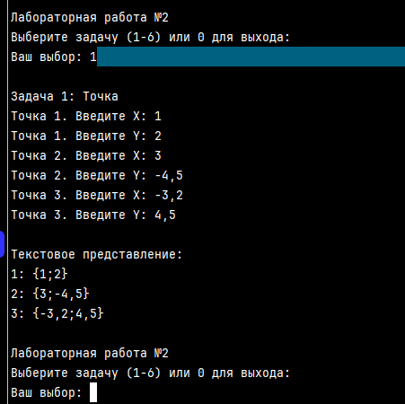
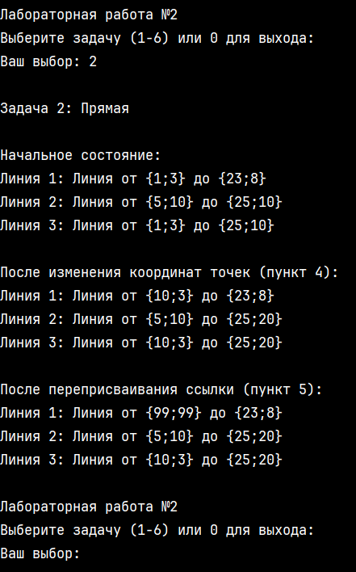
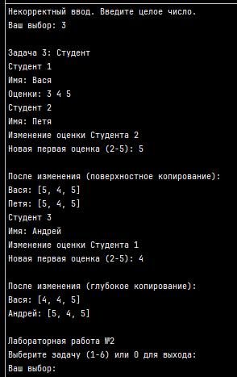
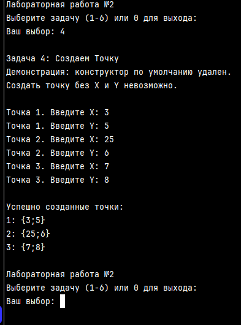
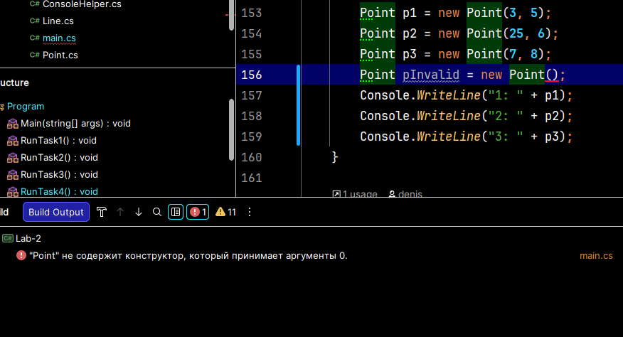
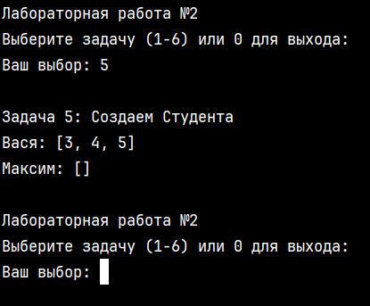
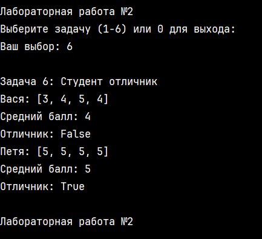

# Лабораторная работа №2 — C#

**Автор:** Чичарин Денис, ИТ-2  
---

## Задание 1

### Задача 1

#### Текст задачи

Создайте сущность Точка, расположенную на двумерной плоскости, которая описывается:
- Координата Х: число
- Координата Y: число
- Может возвращать текстовое представление вида "{X;Y}"

Необходимо создать три точки с разными координатами и вывести на экран их текстовое представление.

#### Алгоритм решения

1. Создать класс `Point`, соблюдая строгую структуру: поля, конструкторы, свойства и методы.
2. Объявить приватные поля `_x` и `_y` типа `double` для хранения координат точки.
3. Реализовать конструктор с параметрами `x` и `y`, который инициализирует свойства `X` и `Y`.
4. Реализовать конструктор копирования, который создаёт новую точку, копируя координаты из другой точки.
5. Реализовать публичные свойства `X` и `Y` с явными методами `get` и `set`. В блоке `set` добавить проверку на корректность числа (отсутствие `NaN` или бесконечности) с использованием `double.IsNaN()` и `double.IsInfinity()`.
6. Переопределить метод `ToString()`, который возвращает строку в формате `"{X;Y}"` путём конкатенации строк и значений полей `_x` и `_y`.
7. В главном методе `Main` организовать цикл меню для выбора задачи.
8. Для задачи 1 создать метод `RunTask1()`, который трижды запрашивает координаты X и Y у пользователя с использованием `ConsoleHelper.ReadDouble()` для защиты от некорректного ввода.
9. Создать три экземпляра класса `Point` (`p1`, `p2`, `p3`), вызвав конструктор с параметрами для каждой точки.
10. Вывести на экран текстовое представление каждой точки через `Console.WriteLine()`, который автоматически вызывает метод `ToString()` при конкатенации со строкой.

#### Тестирование

  

---

## Задание 2: Прямая

### Текст задачи

Создайте сущность Линия, расположенную на двумерной плоскости, которая описывается:
- Координата начала: Точка
- Координата конца: Точка
- Может возвращать текстовое представление вида "Линия от {X1;Y1} до {X2;Y2}"

Для указания координат нужно использовать сущность Точка, разработанную в задании 1.1. Создайте линии со следующими характеристиками:
1. Линия 1 с началом в т. {1;3} и концом в т.{23;8}.
2. Линия 2, горизонтальная, на высоте 10, от точки 5 до точки 25.
3. Линия 3, которая начинается всегда там же, где начинается линия 1, и заканчивается всегда там же, где заканчивается линия 2. Таким образом, если положение первой или второй линии меняется, то меняется и третья линия.
4. После создания всех трех объектов измените координаты первой и второй линий, причем сделайте это таким образом, чтобы положение третьей линии соответствовало требованиям пункта 3.
5. Измените координаты первой линии так, чтобы при этом не изменились координаты третьей линии.

### Алгоритм решения

1. Создать класс `Line`, соблюдая строгую структуру: поля, конструкторы, свойства и методы.
2. Объявить приватные поля `_start` и `_end` типа `Point` для хранения начала и конца линии. Поскольку `Point` — ссылочный тип, поля хранят ссылки на объекты, а не копии.
3. Реализовать конструктор с параметрами `start` и `end`, который инициализирует свойства `Start` и `End`.
4. Реализовать конструктор копирования с **глубоким копированием**: создаёт новые объекты `Point`, копируя координаты из другой линии. Это обеспечивает независимость копий.
5. Реализовать публичные свойства `Start` и `End` с явными методами `get` и `set`. В блоке `set` добавить проверку на `null` с выбрасыванием `ArgumentException`.
6. Переопределить метод `ToString()`, который возвращает строку в формате `"Линия от {X1;Y1} до {X2;Y2}"` путём конкатенации строк и вызова `ToString()` для точек начала и конца.
7. В методе `RunTask2()` создать три линии:
   - Линия 1: начало `{1;3}`, конец `{23;8}`.
   - Линия 2: горизонтальная на высоте 10, от `{5;10}` до `{25;10}`.
   - Линия 3: использует **те же объекты** `Point`, что и Линии 1 и 2 (`line1.Start` и `line2.End`), демонстрируя ссылочную связь.
8. Вывести начальное состояние всех трёх линий.
9. **Пункт 4:** Изменить координаты внутри точек (`line1.Start.X = 10` и `line2.End.Y = 20`). Поскольку Линия 3 ссылается на те же объекты, её координаты тоже изменятся.
10. **Пункт 5:** Переприсвоить ссылку (`line1.Start = new Point(99, 99)`). Создать новый объект `Point` и направить ссылку линии 1 на него. Линия 3 продолжит ссылаться на старый объект, поэтому её координаты не изменятся.
11. Вывести состояние линий после каждого изменения для демонстрации разницы между изменением координат внутри объекта и переприсваиванием ссылки.

### Тестирование

  

---

## Задание 3: Студент

### Текст задачи

Создайте сущность Студент, которая описывается:
- Имя: строка
- Оценки: массив целых чисел
- Может возвращать текстовое представление вида "Имя: [оценка1, оценка2,…,оценкаN]"

Необходимо выполнить следующие задачи:
1. Создать студента Васю с оценками: 3, 4, 5.
2. Создать студента Петю и скопировать оценки Васи, присвоив содержимое поля с оценками Васи полю с оценками Пети.
3. Заменить первую оценку Пети на число 5. Вывести на экран строковое представление Васи и Пети. Объяснить результат.
4. Создать студента Андрея и скопировать ему оценки Васи так, чтобы изменение оценок Васи не влияло на Андрея.

### Алгоритм решения

1. Создать класс `Student`, соблюдая строгую структуру: поля, конструкторы, свойства и методы.
2. Объявить приватные поля `_name` типа `string` и `_grades` типа `int[]` для хранения имени и оценок студента. Поскольку массив — ссылочный тип, поле хранит ссылку на объект массива в памяти.
3. Реализовать конструктор с параметрами `name` и `grades` (где `grades` имеет значение по умолчанию `null`), который инициализирует свойства `Name` и `Grades`.
4. Реализовать конструктор копирования с **глубоким копированием**: создаёт новый массив и поэлементно копирует значения из другого студента. Это обеспечивает независимость копий.
5. Реализовать публичное свойство `Name` с явными методами `get` и `set`. В блоке `set` добавить проверку на пустую строку с использованием `string.IsNullOrWhiteSpace()`.
6. Реализовать публичное свойство `Grades` с явными методами `get` и `set`. В блоке `set` добавить проверку на `null`: если передан `null`, создать пустой массив `new int[0]`.
7. Реализовать метод `GetAverageGrade()`, который вычисляет средний балл. Использовать явное приведение типа `(double)sum` для корректного вещественного деления. Добавить защиту от деления на ноль.
8. Реализовать метод `IsExcellent()`, который проверяет, является ли студент отличником (все оценки равны 5 и есть хотя бы одна оценка).
9. Переопределить метод `ToString()`, который возвращает строку в формате `"Имя: [оценка1, оценка2,…]"` путём конкатенации имени и результата вызова `ConsoleHelper.ToString(_grades)`.
10. В методе `RunTask3()` выполнить следующие шаги:
    - **Пункт 1:** Создать массив оценок `{3, 4, 5}` и студента Васю с этими оценками.
    - **Пункт 2:** Создать студента Петю без оценок, затем выполнить поверхностное копирование: `petya.Grades = vasya.Grades`. Теперь оба студента ссылаются на один массив.
    - **Пункт 3:** Изменить первую оценку Пети: `petya.Grades[0] = 5`. Вывести обоих студентов. Объяснить, что оценки Васи тоже изменились, потому что массив один.
    - **Пункт 4:** Создать студента Андрея. Выполнить глубокое копирование: создать новый массив `new int[vasya.Grades.Length]` и в цикле скопировать каждый элемент из массива Васи. Присвоить новый массив свойству `Grades` Андрея.
    - Изменить первую оценку Васи: `vasya.Grades[0] = 2`. Вывести обоих студентов. Показать, что оценки Андрея не изменились, потому что массивы независимы.

### Тестирование

  

---

## Задание 4: Создаем Точку

### Текст задачи

Измените сущность Точка из задачи 1.1. В соответствии с новыми требованиями создать объект Точки можно только путем указания обеих координат: X и Y.

Необходимо выполнить следующие задачи:
- Создайте и выведите на экран точку с координатами 3;5
- Создайте и выведите на экран точку с координатами 25;6
- Создайте и выведите на экран точку с координатами 7;8

### Алгоритм решения

1. Изменить класс `Point`, удалив конструктор по умолчанию (без параметров). Оставить только конструктор с параметрами `(double x, double y)` и конструктор копирования `(Point other)`.
2. Это изменение гарантирует, что создать точку можно только указав обе координаты. Попытка вызвать `new Point()` приведёт к ошибке компиляции: *"Point does not contain a constructor that takes 0 arguments"*.
3. Остальная структура класса остаётся без изменений: приватные поля `_x` и `_y`, публичные свойства `X` и `Y` с проверками на `NaN` и бесконечность в сеттерах, переопределённый метод `ToString()`.
4. В методе `RunTask4()` создать три объекта класса `Point` с заданными координатами:
   - `p1 = new Point(3, 5)`
   - `p2 = new Point(25, 6)`
   - `p3 = new Point(7, 8)`
5. Вывести на экран текстовое представление каждой точки через `Console.WriteLine()`, который автоматически вызывает метод `ToString()`.

### Тестирование

  

  

---

## Задание 5: Создаем Студента

### Текст задачи

Измените сущность Студент из задачи 3.1. Новые требования включают:
- Студента можно создать указав только имя
- Студента можно создать указав имя и набор оценок
- Оба способа должны быть реализованы единственным конструктором

Создайте и выведите на экран следующие объекты:
1. Студент Вася с оценками: 3, 4, 5.
2. Студент Максим без оценок.

### Алгоритм решения

1. Использовать существующий конструктор класса `Student` с необязательным параметром: `public Student(string name, int[] grades = null)`.
2. Параметр `grades` имеет значение по умолчанию `null`. Это позволяет вызывать конструктор двумя способами:
   - С оценками: `new Student("Вася", new int[] { 3, 4, 5 })`
   - Без оценок: `new Student("Максим")` (параметр `grades` автоматически получает `null`)
3. В сеттере свойства `Grades` добавить проверку: если `value == null`, создать пустой массив `new int[0]`. Это гарантирует, что поле `_grades` всегда содержит валидный массив, даже если оценок нет.
4. В методе `RunTask5()` создать двух студентов:
   - Вася: `new Student("Вася", new int[] { 3, 4, 5 })`
   - Максим: `new Student("Максим")`
5. Вывести на экран текстовое представление каждого студента через `Console.WriteLine()`, который автоматически вызывает метод `ToString()`.

### Тестирование

  

---

## Задание 6: Студент отличник

### Текст задачи

Измените сущность Студент из задачи 4.7. Новые требования включают:
- Студент может возвращать значение своей средней оценки (вещественное число). Если оценок нет, то среднее – 0.
- Студент может возвращать информацию о том, является ли он отличником или нет. Студент является отличником если у него есть хотя бы одна оценка и все оценки только отличные.

Необходимо выполнить следующие задачи:
1. Создайте студента Васю с оценками 3, 4, 5, 4.
2. Создайте студента Петю с оценками 5, 5, 5, 5.
3. Выведите для обоих студентов информацию о среднем балле и являются ли они отличниками.

### Алгоритм решения

1. Добавить в класс `Student` метод `GetAverageGrade()`, который вычисляет средний балл:
   - Проверить, что массив оценок не пустой (`_grades.Length == 0`). Если пустой — вернуть 0.
   - Инициализировать переменную `sum = 0` для накопления суммы оценок.
   - В цикле `for` пройти по всем оценкам и добавить каждую к сумме.
   - Вернуть результат деления `(double)sum / _grades.Length`. Явное приведение типа `(double)` необходимо для корректного вещественного деления (иначе дробная часть будет отброшена).
2. Добавить в класс `Student` метод `IsExcellent()`, который проверяет, является ли студент отличником:
   - Проверить, что массив оценок не пустой. Если пустой — вернуть `false` (по условию нужна хотя бы одна оценка).
   - В цикле `for` пройти по всем оценкам. Если хотя бы одна оценка не равна 5 — сразу вернуть `false` (ранний выход из метода).
   - Если цикл завершился и все оценки равны 5 — вернуть `true`.
3. В методе `RunTask6()` создать двух студентов:
   - Вася: `new Student("Вася", new int[] { 3, 4, 5, 4 })`
   - Петя: `new Student("Петя", new int[] { 5, 5, 5, 5 })`
4. Для каждого студента вывести:
   - Текстовое представление через `ToString()` (автоматически вызывается при конкатенации со строкой).
   - Средний балл через вызов `GetAverageGrade()`.
   - Информацию об отличии через вызов `IsExcellent()`.
   - 
### Тестирование

  

---
